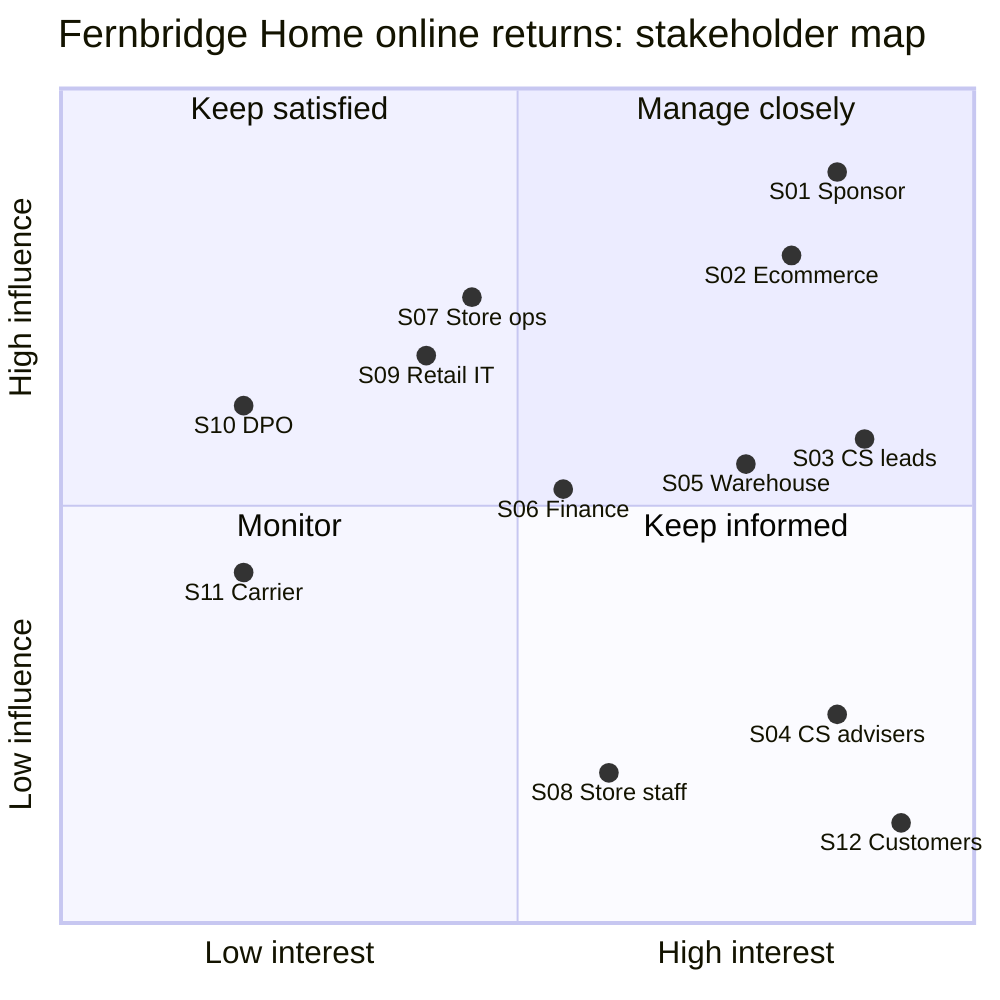

# 02. Stakeholders and RACI

> **Practice case study.** Fernbridge Home is fictional; roles are typical of a mid-sized UK retailer.

Built from the [stakeholder register](https://github.com/Vinayak-Koranga-Analyst/ba-toolkit/blob/main/templates/01-stakeholder-register.md) and [RACI](https://github.com/Vinayak-Koranga-Analyst/ba-toolkit/blob/main/templates/02-raci-matrix.md) templates.

## 1. Stakeholder register

| ID | Stakeholder / group | Interest in the change | Influence | Interest | Current view | Key concerns | Engagement approach |
|---|---|---|---|---|---|---|---|
| S01 | Director of Customer Operations (sponsor) | Lower call volumes and complaints | H | H | Supportive | Cost, go-live before January | Fortnightly steering; sign-off of brief and BRD |
| S02 | Head of Ecommerce (product owner) | Better customer journey, fewer abandoned returns | H | H | Supportive | Website release slots, app changes | Weekly backlog review; owns prioritisation |
| S03 | Customer services team leaders | Fewer "where's my refund" calls | M | H | Supportive | Still need to handle exceptions; how to see return status | Workshops; review of as-is / to-be maps |
| S04 | Customer services advisers | Less chasing and re-keying | L | H | Neutral | Change to scripts and systems; training | Process walk-through; UAT testers |
| S05 | Returns warehouse manager | Clear view of what's coming in | M | H | Neutral | Inspection rules; extra scanning step | Site visit; workshop on inspection and grading |
| S06 | Finance (refunds and reconciliation) | Fewer manual refunds, cleaner reconciliation | M | M | Neutral | Refund fraud; audit trail | Workshop on refund rules; review of NFRs |
| S07 | Store operations manager | Stop turning customers away | H | M | Resistant | Till queues, stock space, staff time | Early 1:1; pilot in two stores; keep satisfied |
| S08 | Store colleagues | Simple way to handle online returns | L | M | Neutral | Training, extra work at busy times | Store champions; short guides; feedback survey |
| S09 | Retail IT / OMS team | Delivery of OMS and till changes | H | M | Neutral | Capacity, technical risk | Technical spike; joint refinement sessions |
| S10 | Data Protection Officer | UK GDPR compliance | H | L | Neutral | Customer data shown at till; retention | Early review; DPIA screening; keep satisfied |
| S11 | Carrier account manager (external) | Return label volumes | M | L | Supportive | API set-up and pricing | Via logistics manager |
| S12 | Online customers | Easy returns and quick refunds | L | H | (not asked yet) | Speed, clarity, convenience | Survey of recent returners; usability testing |

## 2. Power / interest map

## 3. Key points from the analysis

- **Store operations (S07) is the main risk.** High influence and currently resistant, because in-store returns add work at the till. A two-store pilot and clear rules on stock handling should come before roll-out to all stores.
- **The Data Protection Officer (S10) has low day-to-day interest but can stop go-live.** Showing customer order details at the till needs a DPIA screening early, not just before launch.
- **Customers (S12) haven't been asked yet.** A short survey of recent returners will test the assumption that customers want to track their return online.

## 4. RACI

| Activity / deliverable | Sponsor (S01) | Product owner (S02) | BA | Project manager | CS leads (S03) | Warehouse mgr (S05) | Finance (S06) | Store ops (S07) | Retail IT (S09) | DPO (S10) |
|---|---|---|---|---|---|---|---|---|---|---|
| Approve project brief | A | C | R | R | I | I | I | C | I | I |
| Map as-is process | I | C | A/R | I | C | C | C | C | I | I |
| Design to-be process | I | A | R | I | C | C | C | C | C | C |
| Write and baseline BRD | C | A | R | C | C | C | C | C | C | C |
| Agree refund rules | C | C | R | I | C | C | A | I | I | I |
| DPIA screening | I | C | C | I | I | I | I | C | C | A/R |
| Write user stories | I | A | R | I | C | C | C | C | C | I |
| Prioritise backlog | C | A/R | C | C | C | C | C | C | C | I |
| Build OMS and till changes | I | C | C | C | I | I | I | I | A/R | I |
| Write UAT scripts | I | C | R | A | C | C | C | C | I | I |
| Run UAT | I | C | C | A | R | R | R | R | C | I |
| Store pilot (2 stores) | I | C | C | R | I | I | I | A | C | I |
| Go-live decision | A | R | C | R | C | C | C | C | C | C |

Each activity has exactly one Accountable.
