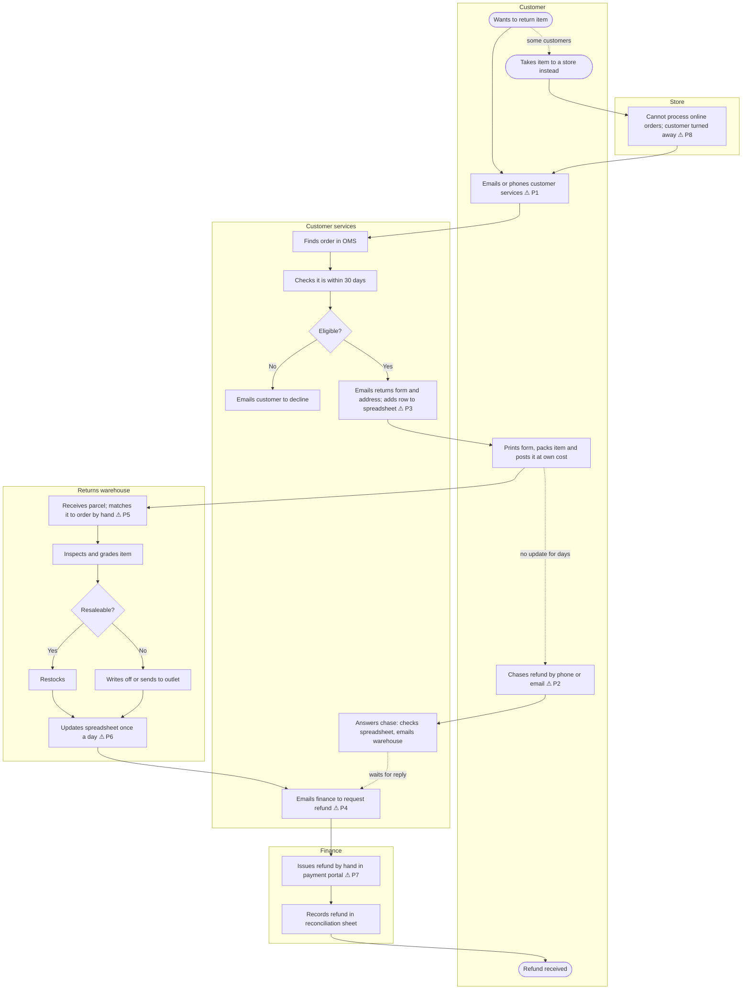

# 03. As-Is Process: Online Returns

> **Practice case study.** Fernbridge Home is fictional and all figures are illustrative.

Built from the [process map template](https://github.com/Vinayak-Koranga-Analyst/ba-toolkit/blob/main/templates/04-process-map.md).

## 1. Process summary

| Item | Detail |
|---|---|
| Trigger | Customer wants to return an item from an online order (within 30 days) |
| End point | Refund reaches the customer, and the item is restocked or written off |
| Actors | Customer, customer services, returns warehouse, finance, store colleagues |
| Systems | Website, email inbox, shared returns spreadsheet, order management system (OMS), payment provider portal |
| Volume | ~1,800 returns a month |
| Cycle time | Average 12 days from request to refund (sample of 200) |

## 2. As-is process map

⚠ marks a pain point. The references (P1, P2...) link to the log below.

## 3. Step timings (sample of 200 returns)

| Stage | Average elapsed time |
|---|---|
| Request received → returns form sent | 1.5 days |
| Form sent → parcel arrives at warehouse | 4 days |
| Parcel arrives → inspected and spreadsheet updated | 3 days |
| Spreadsheet updated → refund requested from finance | 1.5 days |
| Refund requested → refund issued | 2 days |
| **Total** | **12 days** |

Two-thirds of the total (8 of 12 days) is internal handling and waiting between teams. Only the 4 days in the post are outside Fernbridge's control.

## 4. Pain-point log

| ID | Step | Pain point | Evidence | Impact | Idea for the to-be |
|---|---|---|---|---|---|
| P1 | Customer starts return | No self-service option; customer must email or call | All returns start by email or phone | Adds 1.5 days; high contact volume | Online return request in account or via order number |
| P2 | Customer waits | No status updates, so customers chase | 40% of returns chased at least once; ~33% of CS calls are about returns | Cost to serve; poor customer experience | Status tracking page and automatic emails/texts |
| P3 | CS logs return | Return tracked in a shared spreadsheet, not the OMS | One spreadsheet with ~1,800 rows a month, edited by two teams | Errors, duplicates, no audit trail | Return record created in the OMS |
| P4 | Refund request | CS emails finance for each refund | Refund requests sent in batches once a day | Adds 1.5 days; refunds missed | Refund triggered automatically after inspection |
| P5 | Warehouse receipt | Parcels matched to orders by hand; forms often missing | Warehouse estimate: 1 in 10 parcels arrive without a form | Delays inspection; mismatched refunds | Return label with QR code linked to the return |
| P6 | Warehouse update | Spreadsheet updated once a day | Warehouse process | Up to 1 day delay | Scan at receipt updates status in real time |
| P7 | Finance refund | Refunds keyed by hand in payment portal | Finance process | Errors in refund amount; 2-day wait | Refund via payment provider API with approval rules |
| P8 | Store | Stores can't accept returns of online orders | Store manager feedback; not recorded | Lost goodwill; customer still has to post item | In-store return using order look-up at the till |

## 5. Root causes

Most of the pain points trace back to three causes:

1. **No single record of a return.** The return lives in emails and a spreadsheet, not in the OMS. Each team has to ask another team for its status (P2, P3, P6).
2. **Hand-offs by email.** Each team passes work to the next by email or in daily batches, which adds waiting time at every step (P1, P4, P6, P7).
3. **Returns designed around posting, not around the customer.** There's no label, no tracking and no store option (P1, P5, P8).

These root causes set the direction for the to-be process: one return record in the OMS, status updated by events (scans, approvals) rather than emails, and more ways for the customer to send the item back.

## 6. Validation

This map would be walked through with a customer services team leader, the returns warehouse manager and a finance refunds analyst, and the timings checked against a sample of 200 returns from the spreadsheet.
