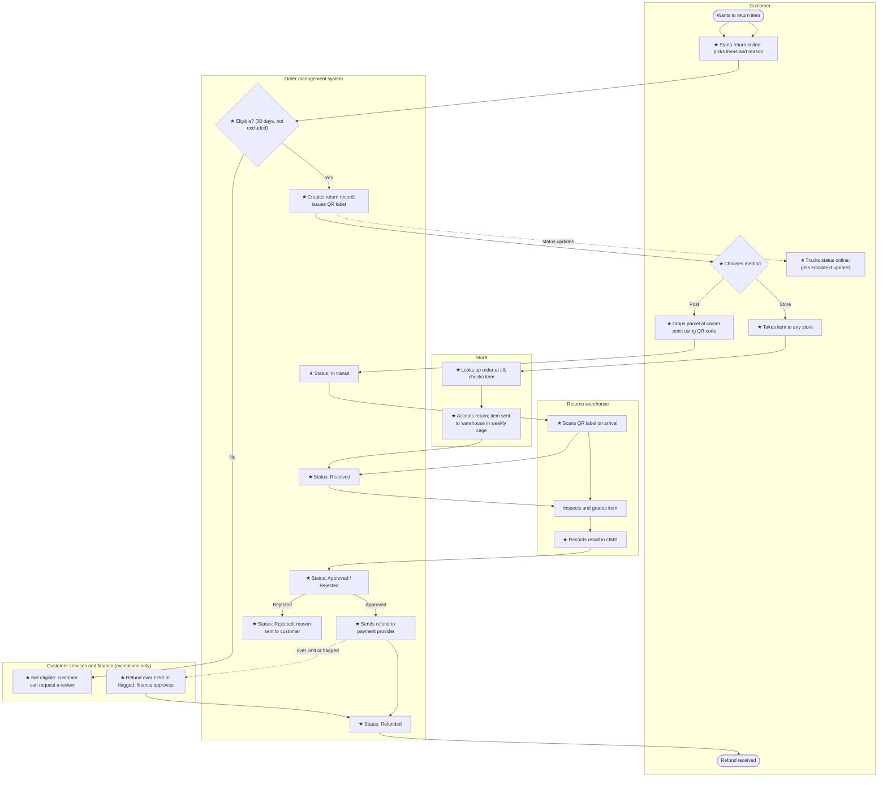

# 04. To-Be Process: Online Returns

> **Practice case study.** Fernbridge Home is fictional and all figures are illustrative.

Built from the [process map template](https://github.com/Vinayak-Koranga-Analyst/ba-toolkit/blob/main/templates/04-process-map.md). Compare with the [as-is process](03-as-is-process.md).

## 1. Design principles

These come from the three root causes found in the as-is analysis:

1. **One record per return.** Every return lives in the order management system (OMS) from the moment it's requested, and every team works from that record.
2. **Events, not emails.** Status changes when something happens (a label scan, an inspection result, a refund), not when someone sends an email.
3. **More ways to send it back.** Customers can post the item with a prepaid label or take it to any store.
4. **People handle exceptions only.** Customer services and finance deal with the cases that need judgement, not with every return.

## 2. To-be process map

★ marks a new or changed step.

### Store returns and refund timing

For store returns, the refund is issued at the till once the colleague has checked the item. The warehouse then grades it for restocking. This rule needs agreement from finance (see BR-08 and the open question in the [BRD](05-brd.md)).

## 3. Change summary

| Step | As-is | To-be | Pain points addressed | Requirements |
|---|---|---|---|---|
| Start a return | Email or phone customer services | Self-service online, with eligibility checked automatically | P1 | BR-01, BR-02, BR-03 |
| Record the return | Row in a shared spreadsheet | Return record in the OMS with status history | P3 | BR-05 |
| Send the item back | Print form, post at own cost | Prepaid QR label or any store | P5, P8 | BR-04, BR-08 |
| Track progress | Customer chases by phone | Online status and email/text updates | P2 | BR-06, BR-07 |
| Warehouse receipt | Matched by hand; spreadsheet updated daily | QR scan updates status straight away | P5, P6 | BR-09, BR-10 |
| Refund | CS emails finance; refund keyed by hand | Automatic refund through payment provider; finance approves exceptions only | P4, P7 | BR-11, BR-12 |
| Exceptions | Every return handled by CS | CS sees full history and handles only exceptions | P2 | BR-13 |
| Reporting | None | Returns dashboard: volumes, reasons, cycle time, backlog | (OBJ-04) | BR-14 |

## 4. Expected cycle time

| Stage | As-is (days) | To-be estimate (days) | Why |
|---|---|---|---|
| Request → label / form sent | 1.5 | 0 | Self-service, label issued straight away |
| In transit to warehouse | 4 | 3–4 | Unchanged (carrier); store returns refunded at the till |
| Arrival → inspection recorded | 3 | 1 | Scan on arrival; inspection same or next day |
| Inspection → refund issued | 3.5 | under 1 | Automatic refund, exceptions only |
| **Total (posted returns)** | **12** | **about 5** | Meets the OBJ-01 target of 5 days or fewer |

The estimate assumes the warehouse can inspect within one working day of receipt. This needs testing with the warehouse manager (S05) against current staffing.
